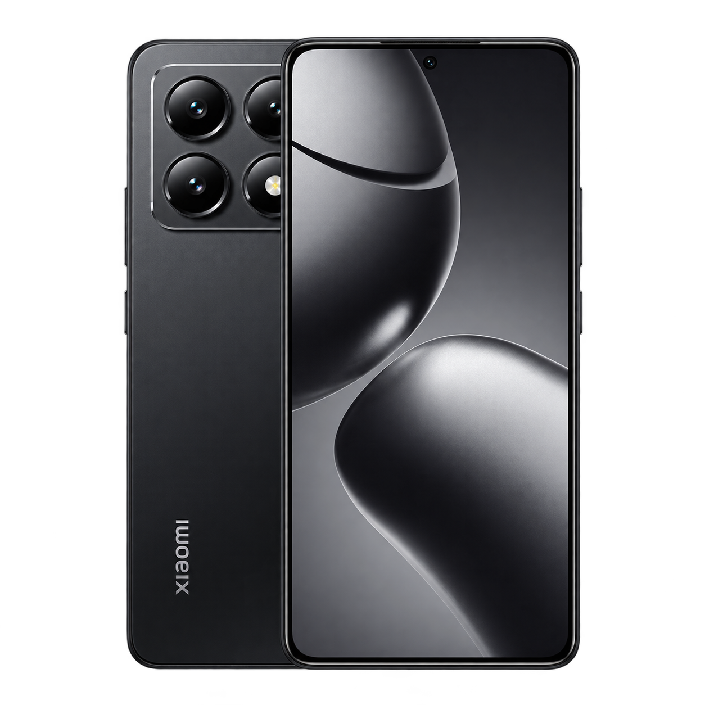

# Windows 11 ARM64 & UEFI on Xiaomi 14T

**English** | [Русский](README.ru-RU.md)

Experimental Windows on ARM (WoA) port for **Xiaomi 14T (`degas`) — MediaTek Dimensity 8300-Ultra (MT6897)**.

Windows PE boots from UFS. CPU, display, touchscreen with multitouch, and UFS read/write work. Hardware buttons work in UEFI only.

> [!IMPORTANT]
> Public installation is not available yet.

- [Project status](guide/English/status.md)
- [Installation](guide/English/installation.md)
- [Mu-Silicium source](mu/) · [Source details & licenses](SOURCE.md)

Maintainer: [soundrust5](https://github.com/soundrust5).

 
